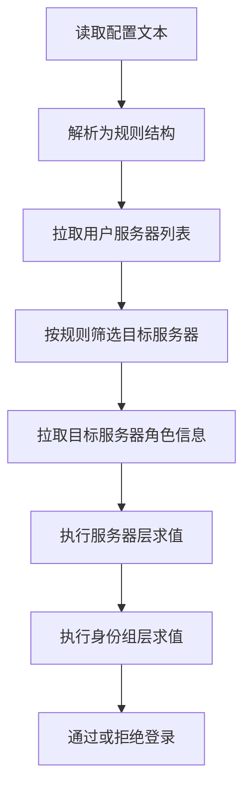

# Discord服务器准入配置重构计划

## 1. 目标

将现有 `Discord 服务器准入配置` 从旧的 `and or` JSON 结构，重构为你定义的新映射结构，仅保留新格式，不做旧格式兼容。

目标语义统一如下：

- `+ID` 表示必须满足
- `-ID` 表示必须不满足
- `ID` 无前缀表示同层至少满足一个
- 服务器层与身份组层都使用同一套语义

## 2. 现状与改造触点

### 后端

- 规则结构与解析位于 `setting/system_setting/discord.go`
- Discord OAuth 校验位于 `oauth/discord.go`
- 当前仅检查服务器成员关系，未检查服务器内身份组

### 前端

- 管理端配置输入与文案位于 `web/src/components/settings/SystemSetting.jsx`
- Discord OAuth 授权 scope 位于 `web/src/helpers/api.js`

## 3. 新规则模型设计

把原始配置解析为可执行规则结构：

- 服务器子句按前缀分三组
  - 必须服务器列表
  - 可选服务器列表
  - 禁止服务器列表
- 每个服务器子句内部再包含一套身份组规则
  - 必须身份组列表
  - 可选身份组列表
  - 禁止身份组列表

### 3.1 求值规则

对每个服务器子句 `serverClause`：

- 先要求用户属于该服务器
- 再判断身份组表达式
  - 必须身份组全部命中
  - 禁止身份组全部不命中
  - 若存在可选身份组，则至少命中一个

然后在服务器层求值：

- 必须服务器全部满足
- 禁止服务器全部不满足
- 若存在可选服务器，则至少满足一个

### 3.2 边界行为

- 空配置表示不限制
- 服务器值为空数组表示仅检查服务器本身
- 去除空白与空字符串
- 对非法项直接判定配置错误

## 4. 解析与校验策略

在 `ParseDiscordGuildRule` 中完成：

1. 解析 JSON 为 `map[string][]string`
2. 服务器 ID 前缀拆分
3. 身份组 ID 前缀拆分
4. 前缀剥离后为空则视为非法配置
5. 去重与标准化
6. 输出内部规则结构

非法配置统一返回当前错误键对应提示，避免新增复杂错误面。

## 5. Discord 数据获取改造

当前只请求：

- `GET users me guilds`

重构后需要补充：

- 针对命中的目标服务器，请求用户在该服务器的成员信息并提取角色列表

实现建议：

- 先拉取服务器列表建立 `guildSet`
- 仅对规则涉及且用户已加入的服务器拉取 member roles
- 缓存单次登录流程中的 guild roles 结果，避免重复请求

## 6. OAuth 授权链路改造

前端 `scope` 需补足读取身份组所需权限。

当前：

- `identify openid guilds`

计划调整：

- 增加 `guilds.members.read`

并保证现有登录跳转与回调流程不变。

## 7. 前端配置文案改造

更新 `Discord 服务器准入配置` 的：

- placeholder
- extraText

内容改为新语法说明，包含至少以下示例：

- 服务器 AND 身份组 OR
- 服务器 AND 身份组 AND
- 服务器 NOT 身份组
- NOT 服务器
- NOT 服务器 AND 身份组

## 8. 测试计划

## 8.1 解析测试

- 空字符串
- 合法映射解析
- 重复 ID 去重
- 空白字符处理
- 非法 JSON
- 非法前缀结果

## 8.2 求值测试

- 仅服务器条件
- 服务器加身份组可选
- 服务器加身份组必须
- 服务器加身份组禁止
- 服务器层可选组
- 服务器层必须组
- 服务器层禁止组
- 组合场景

## 8.3 回归测试

- 空配置可正常 Discord 登录
- 命中规则允许登录
- 不命中规则拒绝登录
- 配置非法时报错文案与当前行为一致

## 9. 实施顺序

1. 重写规则结构与解析器
2. 重写 OAuth 准入求值引擎
3. 补齐 Discord 角色数据拉取
4. 更新前端 OAuth scope
5. 更新管理端文案示例
6. 完成单元测试与回归

## 10. 流程图

## 11. 预期改动文件清单

- `setting/system_setting/discord.go`
- `oauth/discord.go`
- `web/src/helpers/api.js`
- `web/src/components/settings/SystemSetting.jsx`
- 新增或调整相关测试文件
